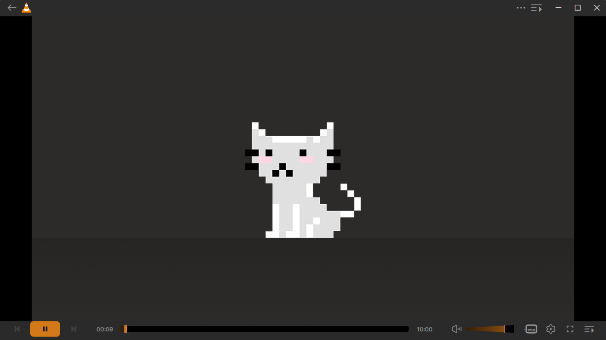
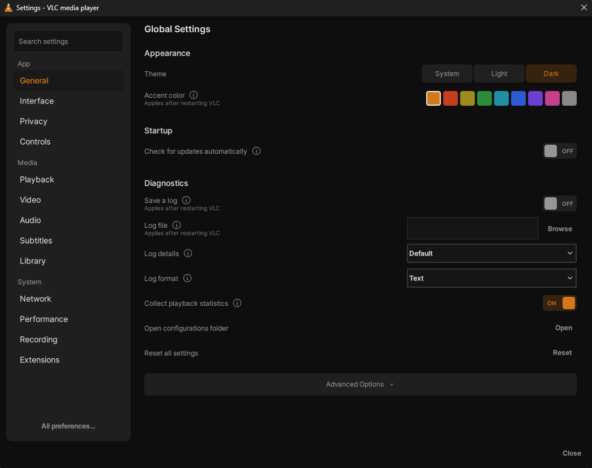
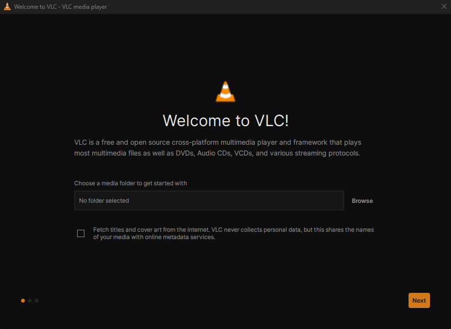
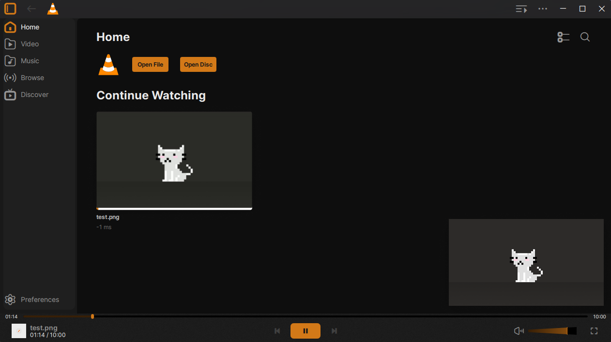
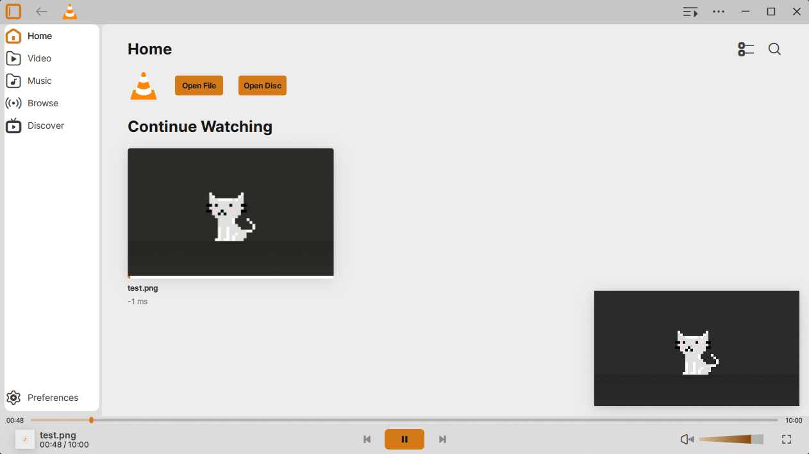
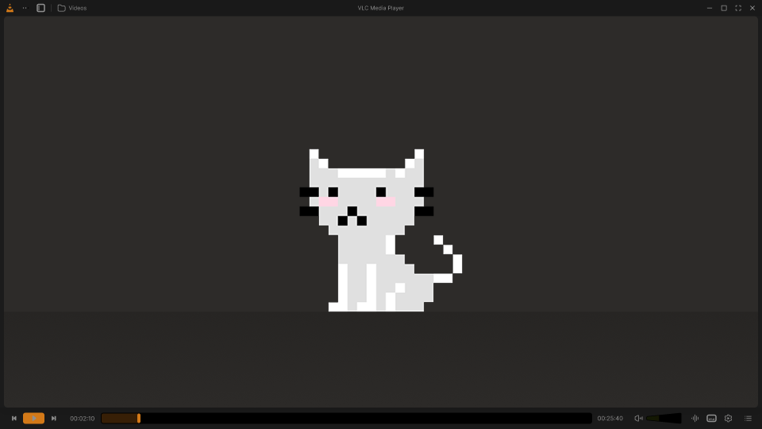

# VLC Redesign (unofficial)

This is an unofficial build of VLC 4 with the interface restyled after "VLC Redesign", a concept that Juxtopposed published on Figma Community.

Only the interface changes. Playback, codecs and every feature are VLC's own.

> This build is not made by or affiliated with VideoLAN or Juxtopposed. VLC 4 is still in development, so expect the occasional bug.



| Settings | Welcome window |
|---|---|
|  |  |

| Library and mini player | Light theme |
|---|---|
|  |  |

For comparison, this is the player screen in Juxtopposed's design:



These screenshots are from the Windows build in this repository. The pixel cat is a placeholder image from the Figma file.

## Install

You need 64-bit Windows 10 or 11. Nothing else.

1. Open the [releases page](https://github.com/Green-Skeleton/vlc-redesign/releases) and, under the newest release, download the file that ends in `-win64.zip`.
2. Right-click the zip and choose **Extract All...**, then **Extract**. Any folder works, for example your Desktop or Documents.
3. Open the extracted folder, then the `vlc-4.0.0-dev` folder inside it, and double-click **vlc.exe**.

That's it. There's no installer and nothing is added to your system.

**If Windows shows "Windows protected your PC"**, click **More info**, then **Run anyway**. The build isn't signed with a paid certificate, so SmartScreen doesn't recognise it. If you'd rather check the file first, see [Checking your download](#checking-your-download).

**The first launch takes up to half a minute** while Windows scans the newly extracted files. After that VLC opens in a few seconds.

**If Windows Firewall asks about network access**, you can click **Cancel**. Local playback works either way. Allowing it only matters for finding media shared on your home network.

### First launch

A welcome window walks you through three short steps: pick a media folder (optional) and choose whether VLC may look up titles and cover art online, pick a theme and accent colour, and see the main keyboard shortcuts. You can change all of it later in Settings.

### Where your settings go

The build runs in portable mode. Settings, the media library and history are stored in the `portable` folder next to `vlc.exe`. It won't touch a VLC you already have installed, and the two can be used side by side.

### Updating

Download the new zip and extract it over the old folder, replacing files when asked. Your `portable` folder, and with it your settings, is kept.

### Uninstalling

Close VLC and delete the folder. Nothing else was installed.

### Checking your download

Each release has a `SHA256SUMS.txt`. In PowerShell, in the folder with the zip, run:

```powershell
Get-FileHash .\VLC-Redesign-unofficial-*-win64.zip -Algorithm SHA256
```

The long number it prints should match the one in `SHA256SUMS.txt`. Every zip is built by GitHub Actions from the source in this repository, and the build log for each release is public under the Actions tab.

## What's different from VLC 4

- **Colours and type:** the design's dark and light palettes, an orange accent (or one of eight others), dark mode by default, and Inter as the interface font
- **Icons:** the design's icon set, traced from the Figma file
- **Player:** a single-row control bar with back, play and next on the left, the seek bar in the middle, and volume, subtitles, settings, fullscreen and the play queue on the right. The play button is an orange pill, the seek bar is thick with a dark orange fill, and the volume control is the design's wedge
- **Library:** the sidebar is a rounded card with the current page marked by its orange icon, and the picture-in-picture player sits in the bottom-right corner
- **Settings:** a new settings window that follows the design. It has 13 pages (General, Interface, Privacy, Controls, Playback, Video, Audio, Subtitles, Library, Network, Performance, Recording and Extensions), a search box that covers all of them, and an "Advanced Options" section on each page. Changes apply as you make them and are saved when the window closes. VLC's full preference tree is still one click away under **All preferences...**
- **Welcome window:** a three-step onboarding in place of VLC's privacy dialog
- **Privacy defaults:** the update check is off, because it would offer the official VLC instead, and online metadata lookups are only turned on if you agree in the welcome window

## What isn't done yet

The design covers a few things this build doesn't:

- The open-file dialogs are still Windows' own
- The mini player keeps VLC 4's layout in the new colours, instead of the design's floating card
- Some library details, such as the design's breadcrumb header
- A few rarely used windows (Media Information, Codec Information, the equalizer) are VLC's older Qt dialogs in the new colours

Only Windows builds exist for now. On macOS, VLC 4 uses a separate native interface, so the redesign wouldn't apply there.

## Security

- Releases are built in public on GitHub Actions from the tagged source. VideoLAN's Windows build image is pinned by its digest and every third-party action is pinned to a full commit hash. The workflow only has read access to the repository, except for the one job that publishes a release.
- Each release includes SHA-256 checksums, and the release job checks them before uploading.
- The build doesn't phone home. The update check is off, and online lookups for titles and artwork need your consent.
- The Settings window only changes VLC's own configuration file in the `portable` folder. It doesn't run anything or change the rest of your system.

If you find a security problem in the redesign changes, please open an issue. Problems in VLC itself should go to VideoLAN: <https://www.videolan.org/security/>.

## Building

GitHub Actions builds the zip (`.github/workflows/build-windows.yml`) with VideoLAN's own Windows cross-compilation image and their prebuilt third-party libraries, the same way VideoLAN's CI does. A push to `redesign` produces the zip as a workflow artifact, and a tag named `redesign-*` publishes a release.

All interface changes are in `modules/gui/qt`. Search for "VLC Redesign" to find them. The settings window is `dialogs/dialogs/qml/Settings*.qml`, with its C++ side in `dialogs/preferences/settings_bridge.cpp`. The welcome window is `dialogs/dialogs/qml/OnboardingDialog.qml`. The icon font was generated from the Figma file with the tools in [vlc-redesign-skin](https://github.com/Green-Skeleton/vlc-redesign-skin).

Using VLC 3? [vlc-redesign-skin](https://github.com/Green-Skeleton/vlc-redesign-skin) is a skin that brings the same design to it.

## Credits

The design is "VLC Redesign" by **Juxtopposed**, published on Figma Community under [CC BY 4.0](https://creativecommons.org/licenses/by/4.0/). The colours, icons and layouts come from that file. The icons were traced from it and adapted to fit VLC's icon font.

VLC itself is made by [VideoLAN](https://www.videolan.org) and the VLC contributors. The player, and almost all of the code in this repository, is their work.

The interface font is [Inter](https://github.com/rsms/inter) by Rasmus Andersson, under the SIL Open Font License 1.1.

## License

VLC is free software under the GNU GPL, version 2 or later, and so is this fork. The full source is in this repository.

"VLC" and the VLC cone are trademarks of VideoLAN. This build is labelled unofficial so nobody mistakes it for VideoLAN's.

VLC's original README follows.

---

# VLC media player

**VLC** is a libre and open source **media player** and **multimedia engine**,
focused on **playing everything**, and **running everywhere**.

**VLC** can play most multimedia files, discs, streams, devices and is also able to
convert, encode, **stream** and manipulate streams into numerous formats.

VLC is used by many over the world, on numerous platforms, for very different use cases.

The **engine of VLC** can be embedded into 3rd party applications, and is called *libVLC*.

**VLC** is part of the [VideoLAN project](https://videolan.org) and
is developed and supported by a community of volunteers.

The VideoLAN project was started at the university [École Centrale Paris](https://www.centralesupelec.fr/) who
relicensed VLC under the GPLv2 license in February 2001. Since then, VLC has
been downloaded **billions** of times.

## License

**VLC** is released under the GPLv2 *(or later)* license.
*On some platforms, it is de facto GPLv3, because of the licenses of dependencies*.

**libVLC**, the engine is released under the LGPLv2 *(or later)* license. \
This allows embedding the engine in 3rd party applications, while letting them to be licensed under other licenses.

# Platforms

VLC is available for the following platforms:
- [Windows] *(from 7 and later, including UWP platforms and all versions of Windows 10)*
- [macOS] *(10.10 and later)*
- [GNU/Linux] and affiliated
- [BSD] and affiliated
- [Android] *(4.2 and later)*, including Android TV and Android Auto
- [iOS] *(9 and later)*, including AppleTV and iPadOS
- Haiku, OS/2 and a few others.

[Windows]: https://www.videolan.org/vlc/download-windows.html
[macOS]: https://www.videolan.org/vlc/download-macosx.html
[GNU/Linux]: https://www.videolan.org/vlc/#download
[BSD]: https://www.videolan.org/vlc/download-freebsd.html
[Android]: https://www.videolan.org/vlc/download-android.html
[iOS]: https://www.videolan.org/vlc/download-ios.html

Not all platforms receive the same amount of care, due to our limited resources.

**Nota Bene**: The [Android app](https://code.videolan.org/videolan/vlc-android/) and
the [iOS app](https://code.videolan.org/videolan/vlc-ios/) are located in different repositories
than the main one.

# Contributing & Community

**VLC** is maintained by a community of people, and VideoLAN is not paying any of them.\
The community is composed of developers, helpers, maintainers, designers and writers that want
this open source project to thrive.

The main development of VLC is done in the C language, but this repository also contains
plenty of C++, Obj-C, asm and Rust.

Other repositories linked to vlc are done in languages including Kotlin/Java [(Android)](https://code.videolan.org/videolan/vlc-android/),
Swift [(iOS)](https://code.videolan.org/videolan/vlc-ios/), and C# [(libVLCSharp)](https://code.videolan.org/videolan/libvlcsharp/).

We need help with the following tasks:
- Coding
- Packaging for Windows, macOS and Linux distributions
- Technical writing for the documentation
- Design
- Support
- Community management and communication.

Please contribute :)

We are on IRC. You can find us on the **#videolan** channel on *[Libera.chat]*.

[Libera.chat]: https://libera.chat

## Contributions

Contributions are now done through Merge Requests on our [GitLab repository](https://code.videolan.org/videolan/vlc/).

CI and discussions should be resolved before a Merge Request can be merged.

# libVLC

**libVLC** is an embeddable engine for 3rd party applications and frameworks.

It runs on the same platforms as VLC *(and sometimes on more)* and can provide playback,
streaming and conversion of multimedia files and streams.


**libVLC** has numerous bindings for other languages, such as C++, Python and C#.

# Support

## Links

Some useful links that might help you:

- [VLC web site](https://www.videolan.org/vlc/)
- [Support](https://www.videolan.org/support/)
- [Forums](https://forum.videolan.org/)
- [Wiki](https://wiki.videolan.org/)
- [Developer's Corner](https://wiki.videolan.org/Developers_Corner)
- [VLC hacking guide](https://wiki.videolan.org/Hacker_Guide)
- [Bugtracker](https://code.videolan.org/videolan/vlc/-/issues)
- [VideoLAN web site](https://www.videolan.org/)

## Source Code sitemap
```
ABOUT-NLS          - Notes on the Free Translation Project.
AUTHORS            - VLC authors.
COPYING            - The GPL license.
COPYING.LIB        - The LGPL license.
INSTALL            - Installation and building instructions.
NEWS               - Important modifications between the releases.
README             - Project summary.
THANKS             - VLC contributors.

bin/               - VLC binaries.
bindings/          - libVLC bindings to other languages.
compat/            - compatibility library for operating systems missing
                     essential functionalities.
contrib/           - Facilities for retrieving external libraries and building
                     them for systems that don't have the right versions.
doc/               - Miscellaneous documentation.
extras/analyser    - Code analyser and editor specific files.
extras/buildsystem - Different build system specific files.
extras/misc        - Files that don't fit in the other extras/ categories.
extras/package     - VLC packaging specific files such as spec files.
extras/tools/      - Facilities for retrieving external building tools needed
                     for systems that don't have the right versions.
include/           - Header files.
lib/               - libVLC source code.
modules/           - VLC plugins and modules. Most of the code is here.
po/                - VLC translations.
share/             - Common resource files.
src/               - libvlccore source code.
test/              - Testing system.
```
