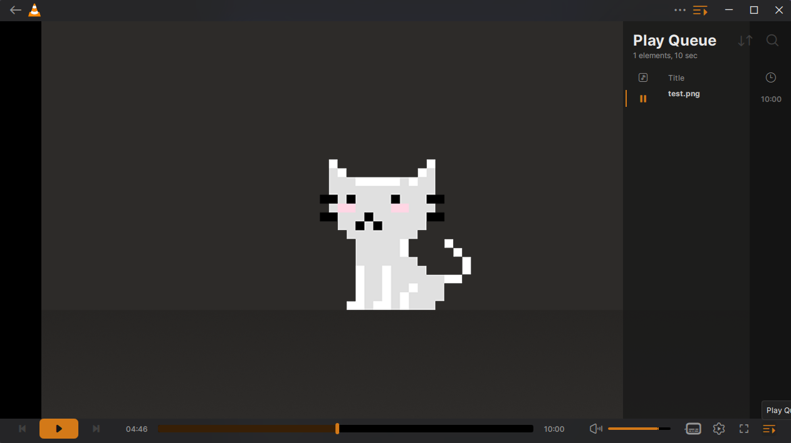

# VLC Redesign (unofficial)

This is an unofficial build of VLC 4 with the interface restyled after "VLC Redesign", a concept that Juxtopposed published on Figma Community.

Only the interface changes. Playback, codecs and every feature are VLC's own.

> This build is not made by or affiliated with VideoLAN or Juxtopposed. VLC 4 is still in development, so expect the occasional bug.


| Library and mini player | Play queue |
|---|---|
|  |  |

For comparison, this is the player screen in Juxtopposed's design:


These screenshots are from the Windows build in this repository. The pixel cat is a placeholder image from the Figma file.

## Download

For 64-bit Windows 10 or 11, download the zip from the [latest release](https://github.com/Green-Skeleton/vlc-redesign/releases/latest), unzip it anywhere and run `vlc.exe`.

There's no installer. The zip runs in portable mode: its settings stay in the `portable` folder next to `vlc.exe`, so it won't touch a VLC you already have installed.

The first launch can take about half a minute while Windows checks the newly unzipped files. After that it opens in a few seconds. Windows Firewall may also ask whether VLC can use public networks. Playback works either way; the setting only matters for finding media shared on your network.

## What's different from VLC 4

- The design's dark colour palette and orange accent, with dark mode on by default
- Inter as the interface font
- The design's icon set
- A single-row control bar, with back, play and next on the left, the seek bar in the middle, and volume, subtitles, settings, fullscreen and the play queue on the right
- An orange pill-shaped play button and a thick seek bar with a dark orange progress fill
- The left sidebar drawn as a rounded card, with the current page marked by its orange icon
- Solid bars above and below the video, as in the design's player screen
- No update check, because it would offer the official VLC instead

## What isn't done yet

The design covers more than this build does. These parts still look like stock VLC 4:

- Settings, which are still VLC's older Qt dialogs
- Onboarding (the welcome window) and the open-file dialogs
- The mini player, which keeps VLC 4's layout in the new colours instead of the design's floating card
- The volume control, which is still VLC 4's slider rather than the design's wedge
- The light theme
- Some library details, such as the breadcrumb header

Only Windows builds exist for now. On macOS, VLC 4 uses a separate native interface, so the redesign wouldn't apply there.

## Building

GitHub Actions builds the zip (`.github/workflows/build-windows.yml`) with VideoLAN's own Windows cross-compilation image and their prebuilt third-party libraries, the same way VideoLAN's CI does. A push to `redesign` produces the zip as a workflow artifact, and a tag named `redesign-*` publishes a release.

All interface changes are in `modules/gui/qt`. Search for "VLC Redesign" to find them. The icon font was generated from the Figma file with the tools in [vlc-redesign-skin](https://github.com/Green-Skeleton/vlc-redesign-skin).

## Credits

The design is "VLC Redesign" by Juxtopposed, published on Figma Community under [CC BY 4.0](https://creativecommons.org/licenses/by/4.0/). The colours, icons and layout come from that file. The icons were traced from it and adapted to fit VLC's icon font.

VLC itself is made by [VideoLAN](https://www.videolan.org) and the VLC contributors. The player, and almost all of the code in this repository, is their work.

The interface font is [Inter](https://github.com/rsms/inter) by Rasmus Andersson, under the SIL Open Font License 1.1.

## License

VLC is free software under the GNU GPL, version 2 or later, and so is this fork. The full source is in this repository.

"VLC" and the VLC cone are trademarks of VideoLAN. This build is labelled unofficial so nobody mistakes it for VideoLAN's.

VLC's original README follows.

---

# VLC media player

**VLC** is a libre and open source **media player** and **multimedia engine**,
focused on **playing everything**, and **running everywhere**.

**VLC** can play most multimedia files, discs, streams, devices and is also able to
convert, encode, **stream** and manipulate streams into numerous formats.

VLC is used by many over the world, on numerous platforms, for very different use cases.

The **engine of VLC** can be embedded into 3rd party applications, and is called *libVLC*.

**VLC** is part of the [VideoLAN project](https://videolan.org) and
is developed and supported by a community of volunteers.

The VideoLAN project was started at the university [École Centrale Paris](https://www.centralesupelec.fr/) who
relicensed VLC under the GPLv2 license in February 2001. Since then, VLC has
been downloaded **billions** of times.

## License

**VLC** is released under the GPLv2 *(or later)* license.
*On some platforms, it is de facto GPLv3, because of the licenses of dependencies*.

**libVLC**, the engine is released under the LGPLv2 *(or later)* license. \
This allows embedding the engine in 3rd party applications, while letting them to be licensed under other licenses.

# Platforms

VLC is available for the following platforms:
- [Windows] *(from 7 and later, including UWP platforms and all versions of Windows 10)*
- [macOS] *(10.10 and later)*
- [GNU/Linux] and affiliated
- [BSD] and affiliated
- [Android] *(4.2 and later)*, including Android TV and Android Auto
- [iOS] *(9 and later)*, including AppleTV and iPadOS
- Haiku, OS/2 and a few others.

[Windows]: https://www.videolan.org/vlc/download-windows.html
[macOS]: https://www.videolan.org/vlc/download-macosx.html
[GNU/Linux]: https://www.videolan.org/vlc/#download
[BSD]: https://www.videolan.org/vlc/download-freebsd.html
[Android]: https://www.videolan.org/vlc/download-android.html
[iOS]: https://www.videolan.org/vlc/download-ios.html

Not all platforms receive the same amount of care, due to our limited resources.

**Nota Bene**: The [Android app](https://code.videolan.org/videolan/vlc-android/) and
the [iOS app](https://code.videolan.org/videolan/vlc-ios/) are located in different repositories
than the main one.

# Contributing & Community

**VLC** is maintained by a community of people, and VideoLAN is not paying any of them.\
The community is composed of developers, helpers, maintainers, designers and writers that want
this open source project to thrive.

The main development of VLC is done in the C language, but this repository also contains
plenty of C++, Obj-C, asm and Rust.

Other repositories linked to vlc are done in languages including Kotlin/Java [(Android)](https://code.videolan.org/videolan/vlc-android/),
Swift [(iOS)](https://code.videolan.org/videolan/vlc-ios/), and C# [(libVLCSharp)](https://code.videolan.org/videolan/libvlcsharp/).

We need help with the following tasks:
- Coding
- Packaging for Windows, macOS and Linux distributions
- Technical writing for the documentation
- Design
- Support
- Community management and communication.

Please contribute :)

We are on IRC. You can find us on the **#videolan** channel on *[Libera.chat]*.

[Libera.chat]: https://libera.chat

## Contributions

Contributions are now done through Merge Requests on our [GitLab repository](https://code.videolan.org/videolan/vlc/).

CI and discussions should be resolved before a Merge Request can be merged.

# libVLC

**libVLC** is an embeddable engine for 3rd party applications and frameworks.

It runs on the same platforms as VLC *(and sometimes on more)* and can provide playback,
streaming and conversion of multimedia files and streams.


**libVLC** has numerous bindings for other languages, such as C++, Python and C#.

# Support

## Links

Some useful links that might help you:

- [VLC web site](https://www.videolan.org/vlc/)
- [Support](https://www.videolan.org/support/)
- [Forums](https://forum.videolan.org/)
- [Wiki](https://wiki.videolan.org/)
- [Developer's Corner](https://wiki.videolan.org/Developers_Corner)
- [VLC hacking guide](https://wiki.videolan.org/Hacker_Guide)
- [Bugtracker](https://code.videolan.org/videolan/vlc/-/issues)
- [VideoLAN web site](https://www.videolan.org/)

## Source Code sitemap
```
ABOUT-NLS          - Notes on the Free Translation Project.
AUTHORS            - VLC authors.
COPYING            - The GPL license.
COPYING.LIB        - The LGPL license.
INSTALL            - Installation and building instructions.
NEWS               - Important modifications between the releases.
README             - Project summary.
THANKS             - VLC contributors.

bin/               - VLC binaries.
bindings/          - libVLC bindings to other languages.
compat/            - compatibility library for operating systems missing
                     essential functionalities.
contrib/           - Facilities for retrieving external libraries and building
                     them for systems that don't have the right versions.
doc/               - Miscellaneous documentation.
extras/analyser    - Code analyser and editor specific files.
extras/buildsystem - Different build system specific files.
extras/misc        - Files that don't fit in the other extras/ categories.
extras/package     - VLC packaging specific files such as spec files.
extras/tools/      - Facilities for retrieving external building tools needed
                     for systems that don't have the right versions.
include/           - Header files.
lib/               - libVLC source code.
modules/           - VLC plugins and modules. Most of the code is here.
po/                - VLC translations.
share/             - Common resource files.
src/               - libvlccore source code.
test/              - Testing system.
```
